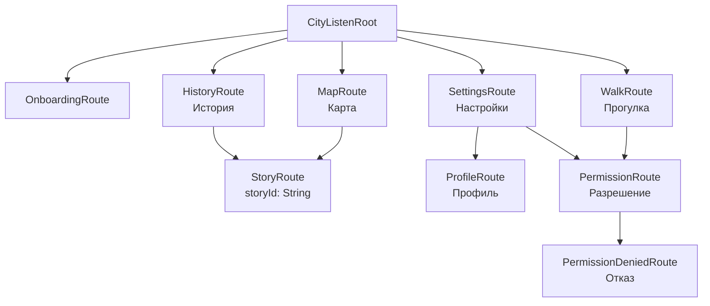

## Навигационный граф

- `CityListenRoot` выбирает стартовый экран по флагу онбординга.
- `OnboardingRoute` после завершения заменяется на `WalkRoute`.
- `PermissionRoute` возвращает на предыдущий экран при согласии или «Не сейчас».
- `PermissionDeniedRoute` после выдачи разрешения в системных настройках возвращает назад.
- У всех маршрутов типобезопасные `@Serializable` объекты; аргумент есть только у `StoryRoute`.
